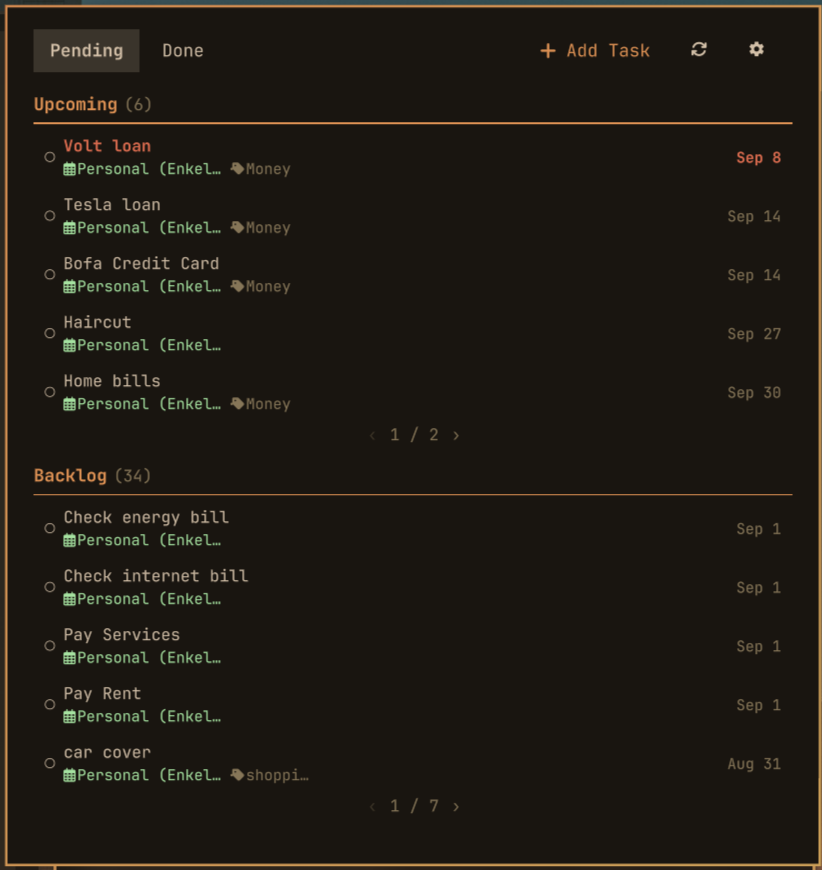
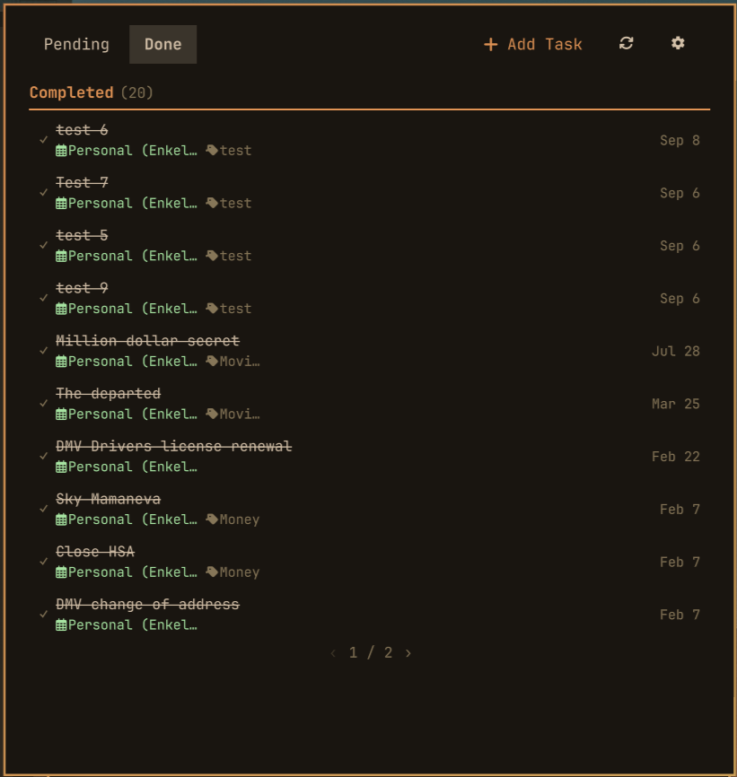
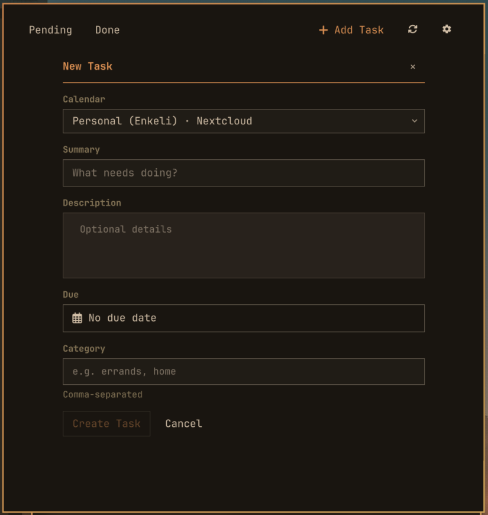
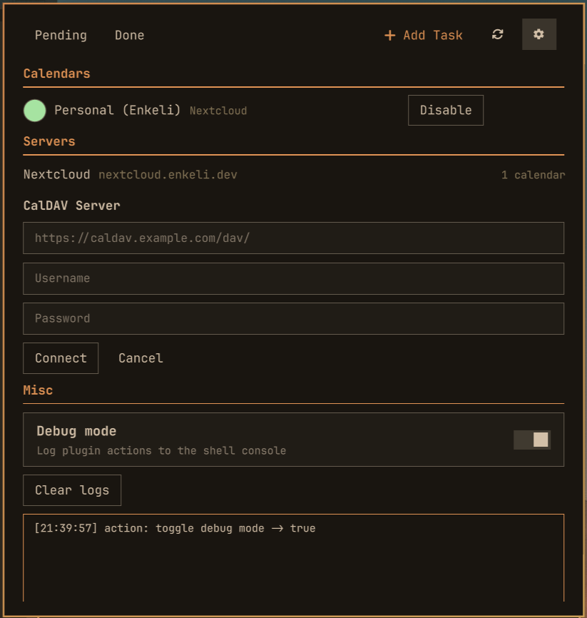

# Nextcloud Tasks

A task widget for the Omarchy shell. Sync with Nextcloud Tasks and manage your to-do list from the bar.

## Previews

| Browse pending tasks | Completed tasks |
| :---: | :---: |
|  |  |
|  |  |

## Install

```bash
omarchy plugin add https://github.com/enkeli/omarchy-dav-tasks --enable
```

## Keyboard

Everything works without the mouse. Press `?` (or `F1`) in the panel for a searchable list of every shortcut; it also lets you rebind them. Defaults mix vim keys with arrow keys:

| Key | Action |
| --- | --- |
| `j` `k` / `Down` `Up` | Move the cursor (crosses pages and sections) |
| `g` `G` / `Home` `End` | First / last task |
| `h` `l` / `Left` `Right` / `PageUp` `PageDown` | Previous / next page |
| `x` / `Space` | Complete or reopen the task |
| `Enter` / `o` | Show or hide details |
| `e` | Edit the task (title, description, starts-by and due dates, categories) |
| `d` / `Delete` | Delete (press twice within 4 seconds) |
| `a` / `n` | New task |
| `/` | Filter tasks |
| `1` `2` `3` / `[` `]` | Pending, Done, Config tabs |
| `r` | Sync |
| `Esc` | Back out one step, then close the panel |
| `Tab` | Next field in forms, otherwise the next bar panel |

In the new-task and edit form: `Tab` / `Shift+Tab` move between fields (the calendar list included), `Ctrl+Enter` creates or saves the task. Starts-by and due dates can be typed in your locale's short date format, shown as the field's placeholder (`Enter` or leaving the field checks them), and the button beside each field opens the picker. `Ctrl+D` opens the due-date picker and `Ctrl+T` the starts-by picker (`h j k l` move by day and week, `H` `L` by month, `t` today, `Enter` picks, `x` clears), `Ctrl+J` / `Ctrl+K` cycle calendars and `Ctrl+L` opens the calendar list. In Config: `Enter` toggles a calendar, `c` picks its color, `s` connects a server.

To rebind, open `?`, highlight an action, press `Ctrl+E` and then the new key. `Ctrl+R` restores one default, `Ctrl+U` unbinds and `Ctrl+Shift+R` (twice) restores all. Bindings are stored in this widget's `shell.json` entry under `keyboardShortcuts`.

## What it does

- View and manage Nextcloud Tasks lists
- Create, edit, and complete tasks
- Two-way sync with your Nextcloud server

## Uninstall

```bash
omarchy plugin disable dev.enkeli.omarchy-dav-tasks
omarchy plugin remove dev.enkeli.omarchy-dav-tasks
```

## Requirements

Omarchy 4, Python 3, and Evolution Data Server (already on Omarchy). License: MIT.

Credentials stay in the system keyring. They are never written to `shell.json` or this repo.

## Development

```bash
./test/all
omarchy plugin validate .
```
